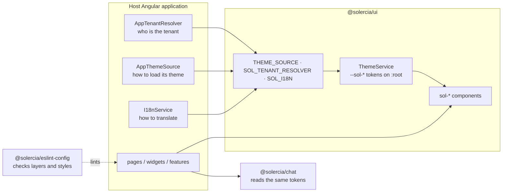
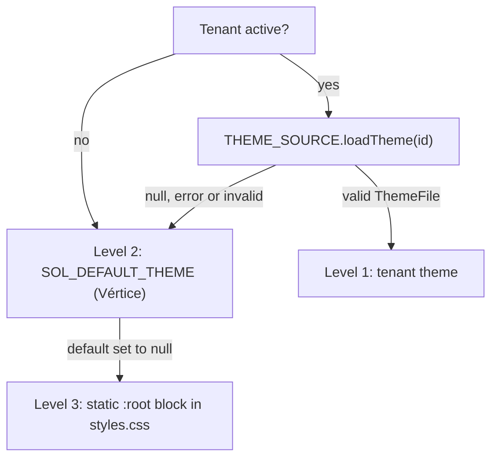
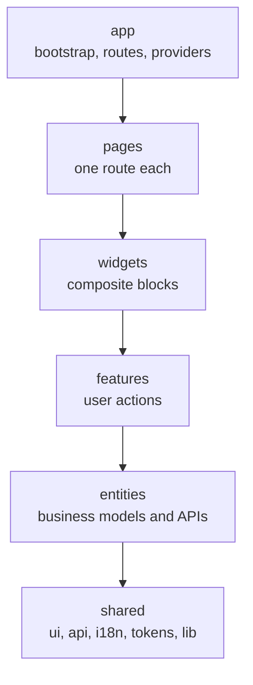

# Architecture

The design system has three packages. The host application implements a few ports; the library does
everything else.

## The three packages

| Package | Version line | Depends on | Ships |
| --- | --- | --- | --- |
| `@solercia/ui` | 0.8 | `@angular/core`, `@angular/common`, `@angular/forms` 22; optional `@angular/cdk`, `chart.js`, `@dagrejs/dagre` | Components, theme runtime, i18n contract and catalogs, `ng add`, generators, secondary entry points `@solercia/ui/theme-studio` and `@solercia/ui/login-appearance` |
| `@solercia/eslint-config` | 0.2 | `eslint` 10, `typescript-eslint` 8, optional `@eslint/css` | FSD boundary, file placement, naming and token-styling rules |
| `@solercia/chat` | 0.4 | `@angular/core`, `@angular/common` 22.1 | `<sol-chat>`, `<sol-chat-flotante>`, `provideSolerciaChat()` |

`@solercia/ui` is the only required package. `ng add @solercia/ui` installs the lint preset for you;
the chat is added only by applications that embed an assistant.

## Ports: what the host provides

The library owns the mechanism; the host owns the policy. Each port is an Angular `InjectionToken`
exported from `@solercia/ui`.

| Port | Question it answers | Contract | Without it |
| --- | --- | --- | --- |
| `THEME_SOURCE` | How do I load a tenant's theme? | `loadTheme(tenantId): Promise<ThemeFile \| null>` | No tenant theme loads; the default applies. |
| `SOL_TENANT_RESOLVER` | Who is the active tenant? | `activeTenantId(): number \| null` | Single-theme mode. |
| `SOL_DEFAULT_THEME` | What applies when there is no tenant theme? | `ThemeFile` | The bundled «Vértice» theme. |
| `SOL_I18N` | How do I translate a key? | `activeLang`, `translate`, `t`, `tMany` | English from the bundled catalog. |
| `SOL_CHART_ENGINE` | Which chart engine renders `sol-chart`? | `SolChartEngineFactory` | Chart.js, loaded on the first chart. |
| `SOL_CALENDAR_COLOR` | How are calendar events colored? | `resolve(event, isDark)` | Derived from `event.color` and tokens. |

Only `provideTheme()` is required. Everything else is optional and has a working default.

## Degradation levels

The theme runtime never leaves the application unstyled. It falls back one level at a time:

| Level | Source | Requires the host? |
| --- | --- | --- |
| 1. Tenant theme | `THEME_SOURCE.loadTheme(tenantId)` | Yes: resolver and source. |
| 2. Default theme | `SOL_DEFAULT_THEME`, bundled «Vértice» | No. |
| 3. Inline CSS | A `:root { --sol-*: … }` block in the host's `styles.css` | Host-owned safety net. |

A failed request, a 404 or an invalid document degrades silently from level 1 to level 2 with a
console warning. See [Theming](./04-theming.md) for the details.

## Application layers (Feature-Sliced Design)

A layer imports only from the layers below it. Inside a layer, code is grouped in slices
(`features/login`, `entities/project`) and segments (`ui`, `model`, `api`, `lib`, `config`). Other
slices import a slice only through its `index.ts`.

| Layer | Holds | Example |
| --- | --- | --- |
| `app` | Bootstrap, root routes, providers | `app.config.ts` with `provideTheme()` |
| `pages` | One routed screen, composition only | `pages/projects/ui/projects-page.component.ts` |
| `widgets` | Self-contained blocks reused across pages | A dashboard summary panel |
| `features` | One user action with its state | `features/invite-member` |
| `entities` | Business models and their API clients | `entities/project/model`, `entities/project/api` |
| `shared` | Code with no business knowledge | Theme and i18n adapters in `shared/tokens`, `shared/i18n` |

`@solercia/ui` components play the role of `shared/ui` for every application: presentational, driven by
inputs, unaware of stores and APIs. Applications add their own `shared/ui` components only when the
library has no equivalent, and those follow the same rules.

## Inside `@solercia/ui`

| Path | Content |
| --- | --- |
| `src/lib/ui/` | One folder per component family (`sol-*`) |
| `src/lib/tokens/` | `ThemeService`, theme ports, the bundled default theme |
| `src/lib/i18n/` | The `SolI18n` contract, `createSolI18n()`, bundled catalogs |
| `src/public-api.ts` | Everything consumers can import |
| `schematics/` | `ng add` and the `page`, `feature`, `entity` and `widget` generators |
| `theme-studio/`, `login-appearance/` | Secondary entry points |

Import every symbol from `@solercia/ui` (or a secondary entry point); deep imports into `lib/` are not
part of the public API.
