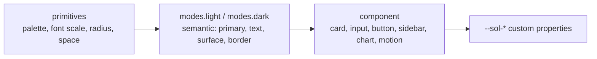

# Theming

```ts
import { Injectable, signal } from '@angular/core';
import type { SolTenantResolver, ThemeFile, ThemeSource } from '@solercia/ui';

/** WHO: the active organization, null before sign-in. */
@Injectable({ providedIn: 'root' })
export class AppTenantResolver implements SolTenantResolver {
  readonly tenantId = signal<number | null>(null);
  activeTenantId(): number | null {
    return this.tenantId();
  }
}

/** HOW: load that organization's theme. Return null to keep the default. */
@Injectable({ providedIn: 'root' })
export class AppThemeSource implements ThemeSource {
  async loadTheme(tenantId: number | string): Promise<ThemeFile | null> {
    const response = await fetch(`/api/tenants/${tenantId}/theme`);
    return response.ok ? ((await response.json()) as ThemeFile) : null;
  }
}
```

Register both with `useExisting` (see [Getting started](./03-getting-started.md#step-5-connect-your-tenant-theme-and-language-optional))
and every component re-skins when `tenantId` changes, without a reload.

## How it works

`ThemeService` (`providedIn: 'root'`, started by `provideTheme()`) is the only consumer of the theme
ports. It:

- reads `SOL_TENANT_RESOLVER.activeTenantId()` inside an effect and asks `THEME_SOURCE` for the theme;
- discards stale responses for a tenant that is no longer active;
- validates the document with `isRenderableTheme()` and keeps the previous or default theme when it
  is not renderable;
- writes the resolved `--sol-*` properties on `document.documentElement`;
- manages light and dark mode as a user preference stored in `localStorage` (`sol-dark-mode`);
- derives the logo, brand name, favicon and one sanitized Google Fonts link.

| Member | Kind | Use |
| --- | --- | --- |
| `activeTheme()` | `Signal<ThemeFile \| null>` | The effective theme. |
| `isDark()` | `Signal<boolean>` | Current mode. |
| `logo()` | `Signal<ThemeLogo \| null>` | Sanitized logo for the active mode. |
| `brandName()` | `Signal<string \| null>` | Logo alternative text or tenant slug. |
| `toggleMode()` / `setDarkMode(dark)` | method | Change the mode and persist it. |
| `setTenantTheme(theme)` | method | Apply a `ThemeFile` directly, bypassing `THEME_SOURCE` (validated). |
| `refresh()` | method | Reload the active tenant's theme, for example after saving it. |

The library never fetches a theme by itself: where the document comes from (an API, a file, a
database `jsonb` column) is the host's decision.

## The `ThemeFile`

A theme is a three-level token document aligned with the W3C Design Tokens format:



```jsonc
{
  "meta": { "tenant": "acme", "logo": { "url": "/assets/acme.svg", "altText": "ACME", "width": 120 } },
  "primitives": { "color": { "brand": { "600": "#6D28D9" } } /* font, radius, space, size, z, borderWidth */ },
  "modes": {
    "light": { "semantic": { "color": { "primary": "{color.brand.600}" } /* … */ }, "component": { /* … */ } },
    "dark":  { "semantic": { "color": { "primary": "{color.brand.600}" } /* … */ }, "component": { /* … */ } }
  }
}
```

- Values can reference primitives with `{path}`, as a whole value or inside a shorthand
  (`"1px solid {color.ink.200}"`).
- Both `modes.light` and `modes.dark` are required.
- Blocks introduced after the first version (card, input, button, sidebar, chart, motion, overlay,
  table, calendar) are optional; a missing block emits its baseline default, so older themes keep
  working.
- Background images accept gradients or `none` only; logos and favicons accept `http`, `https` or
  relative URLs; fonts are Google Fonts built from `family` and `weights`, never from a raw URL.

The full contract, with every field and a minimal complete example, is in
[`THEMING.md`](../../projects/solercia/ui/docs/THEMING.md). The bundled reference theme «Vértice», with
every optional block filled in, is `SOL_BUNDLED_DEFAULT_THEME`.

## The tokens

Use these groups in your own styles. The authoritative list, with the contract path and default of
each variable, is `EMIT_TABLE`.

| Group | Examples |
| --- | --- |
| Color | `--sol-color-primary`, `--sol-color-primary-contrast`, `--sol-color-secondary`, `--sol-color-accent`, `--sol-color-success`, `--sol-color-warning`, `--sol-color-danger`, `--sol-color-info` |
| Text | `--sol-color-text-primary`, `--sol-color-text-secondary`, `--sol-color-text-muted` |
| Surfaces | `--sol-bg-page`, `--sol-bg-surface`, `--sol-bg-sunken`, `--sol-bg-overlay`, `--sol-bg-page-texture` |
| Typography | `--sol-font-family`, `--sol-font-family-mono`, `--sol-font-display`, `--sol-font-numeric`, `--sol-font-size-sm`, `--sol-font-size-base`, `--sol-font-size-lg`, `--sol-font-size-xl`, `--sol-font-weight-bold`, `--sol-line-height` |
| Spacing | `--sol-space-xs`, `--sol-space-sm`, `--sol-space-md`, `--sol-space-lg`, `--sol-space-xl` |
| Shape | `--sol-border-radius-sm`, `--sol-border-radius-md`, `--sol-border-radius-lg`, `--sol-border-radius-full`, `--sol-border-width-default`, `--sol-border-color-default` |
| Elevation | `--sol-shadow-sm`, `--sol-shadow-md`, `--sol-shadow-lg`, `--sol-shadow-card` |
| Sizes | `--sol-size-input-height`, `--sol-size-button-height`, `--sol-size-control-touch`, `--sol-size-header-height`, `--sol-size-sidebar-width` |
| Layers | `--sol-z-dropdown`, `--sol-z-modal`, `--sol-z-tooltip` |
| Motion | `--sol-dur-fast`, `--sol-dur-base`, `--sol-dur-slow`, `--sol-ease`, `--sol-ease-entrance` |
| Components | `--sol-card-*`, `--sol-input-*`, `--sol-button-*`, `--sol-sidebar-*`, `--sol-header-*`, `--sol-chart-1` to `--sol-chart-6` |

```css
.summary {
  padding: var(--sol-space-lg);
  border: var(--sol-border-width-default) solid var(--sol-border-color-default);
  border-radius: var(--sol-border-radius-lg);
  background: var(--sol-bg-surface);
  color: var(--sol-color-text-primary);
}
.summary__value {
  font-family: var(--sol-font-numeric);
  color: var(--sol-color-primary);
}
```

## Your own default theme

Provide your brand theme as the default. It becomes level 2 and the look before sign-in:

```ts
import { SOL_DEFAULT_THEME, type ThemeFile } from '@solercia/ui';
import brandTheme from './brand.theme.json';

export const brandThemeProvider = { provide: SOL_DEFAULT_THEME, useValue: brandTheme as ThemeFile };
```

## Level 3: the static safety net

Add a `:root { --sol-*: … }` block to `styles.css` with literal values. `ThemeService` removes its inline
properties when it has no applicable theme, so this block governs only as a last resort. The lint
preset allows literals where a custom property is defined.

## Editing themes: Theme Studio

`@solercia/ui/theme-studio` provides `<sol-theme-studio>`, a complete theme editor with live preview,
backed by a host store contract (`THEME_STUDIO_STORE`). Use it to let each organization edit its own
theme and call `ThemeService.refresh()` after saving. See
[`THEME-STUDIO.md`](../../projects/solercia/ui/docs/THEME-STUDIO.md).

## Themed sign-in

A theme can carry a `meta.login` block (photos, motion, per-mode composition). The entry point
`@solercia/ui/login-appearance` paints it with `<sol-login-frame>` and ships no authentication logic:
the host projects its own form. See the [README section](../../README.md#themed-sign-in-solerciauilogin-appearance).

## Checklist

- [ ] With no tenant, the application renders on the default theme.
- [ ] Switching tenant re-skins the UI live; a failing theme request keeps the default.
- [ ] Dark mode is independent of the tenant and persists across reloads.
- [ ] No literal color, font or `!important` in component styles.
