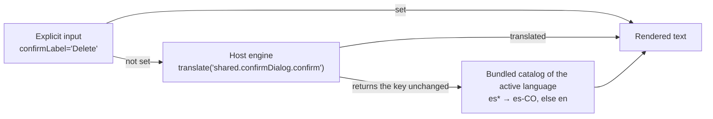

# Internationalization

```ts
import { SOL_I18N, createSolI18n } from '@solercia/ui';

// Colombian Spanish for every component, no i18n engine needed.
export const spanishProvider = { provide: SOL_I18N, useFactory: () => createSolI18n({ lang: 'es-CO' }) };
```

Components never import Transloco, ngx-translate or `@angular/localize`. They depend on one small
contract, `SolI18n`, that the host binds to `SOL_I18N`. The pattern mirrors Angular Material's `*Intl`
services.

## The contract

```ts
import type { Signal } from '@angular/core';

interface SolI18n {
  readonly activeLang: Signal<string>;
  translate(key: string, params?: Record<string, unknown>): string; // missing key: returns the key
  t(key: string, params?: Record<string, unknown>): Signal<string>; // recomputes on language change
  tMany(keys: string[]): Signal<string[]>;
}
```

| Member | Use for |
| --- | --- |
| `activeLang` | Reacting to language changes, for example a language selector. |
| `translate(key, params?)` | One-off lookups in imperative code. |
| `t(key, params?)` | Template bindings; call it in an injection context. |
| `tMany(keys)` | Ordered lists such as stepper labels. |

## Three ways to provide it

| Situation | Provider |
| --- | --- |
| English is enough | Nothing. `SOL_I18N` defaults to `createSolI18n()`, English from the bundled catalog. |
| Spanish or another fixed language, no engine | `{ provide: SOL_I18N, useFactory: () => createSolI18n({ lang: 'es-CO' }) }` |
| The application already uses an engine | A facade with the four members, bound with `useExisting`. |

`createSolI18n(options?)` returns a `SolCatalogI18n` with `setLang(lang)`. Its options are `lang`
(default `'en'`) and `catalogs` (default `{ en: SOL_I18N_EN, 'es-CO': SOL_I18N_ES_CO }`):

```ts
import { SOL_I18N_EN, createSolI18n, type SolI18nCatalog } from '@solercia/ui';

declare const frenchCatalog: SolI18nCatalog;

const i18n = createSolI18n({ lang: 'fr', catalogs: { en: SOL_I18N_EN, fr: frenchCatalog } });
i18n.setLang('en');
```

### Adapter for Transloco

```ts
import { Injectable, Signal, inject } from '@angular/core';
import { TranslocoService, translateSignal } from '@jsverse/transloco';

@Injectable({ providedIn: 'root' })
export class I18nService {
  private readonly transloco = inject(TranslocoService);
  readonly activeLang: Signal<string> = this.transloco.activeLang;

  translate(key: string, params?: Record<string, unknown>): string {
    return this.transloco.translate(key, params);
  }
  t(key: string, params?: Record<string, unknown>): Signal<string> {
    return translateSignal(key, params);
  }
  tMany(keys: string[]): Signal<string[]> {
    return translateSignal(keys);
  }
}

// app.config.ts: { provide: SOL_I18N, useExisting: I18nService }
```

The same shape works for ngx-translate or any other engine: bridge its language-change stream into a
signal with `toSignal` so `activeLang`, `t` and `tMany` recompute. More examples are in
[`I18N.md`](../../projects/solercia/ui/docs/I18N.md).

## Bundled catalogs and fallback

Every visible default text in the library goes through a `shared.*` key. Both catalogs ship with the
package:

| Catalog | Constant | File |
| --- | --- | --- |
| English | `SOL_I18N_EN` | `@solercia/ui/i18n/en.json` |
| Colombian Spanish | `SOL_I18N_ES_CO` | `@solercia/ui/i18n/es-CO.json` |



- An explicit input (`searchPlaceholder`, `actionsLabel`, `confirmLabel`, `label`) always wins.
- When the host engine does not know a `shared.*` key, the component falls back to the bundled
  catalog of the active language, so a host catalog does not need every library key and keys added in
  later versions keep the host language.
- With Transloco or ngx-translate you can also merge `@solercia/ui/i18n/es-CO.json` into your `es-CO`
  translations.

## Inputs that take keys

Inputs whose name ends in `Key` receive an i18n key, not a text: `titleKey` and `descriptionKey` on
`sol-empty-state`, `ariaLabelKey` on `sol-chart` and `sol-number-input`, `labelKey` on timeline nodes.

```html
<sol-empty-state icon="folder-open" titleKey="pages.projects.empty.title" descriptionKey="pages.projects.empty.description" />
```

## Rules for application code

- Put your own texts in your catalog under your own namespaces (`pages.*`, `features.*`); keep
  `shared.*` for the library.
- Never hard-code a visible text in a shared component; take it as an input or a key.
- Tests that assert texts should use the catalogs, not literals typed in the spec.
- `createIdentitySolI18n()` returns keys unchanged and is meant for tests.
