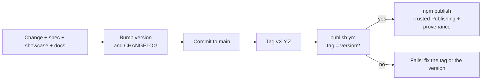

# Releases and contributing

```bash
# One commit on main = one release
npm test && npm run build:showcase
git commit -m "feat(solercia): add sol-segmented-progress"
git tag v0.9.0
git push origin main && git push origin v0.9.0
```

Every commit that lands on `main` is a release and carries its own version tag. The tag triggers the
publish workflow; nobody publishes from a laptop.

## The release flow



1. In the same commit, bump `version` in `projects/solercia/ui/package.json` and add the entry to
   `projects/solercia/ui/CHANGELOG.md`.
2. Commit, then tag the commit with exactly the library version: `git tag v<version>`.
3. Push the commit and the tag.
4. `.github/workflows/publish.yml` runs the tests, checks that the tag matches the version and publishes
   to npm only if that version is not published yet.

An untagged commit on `main` is a defect: tag it before anything else. A pushed tag is never moved or
deleted.

## Versioning

The packages follow [Semantic Versioning](https://semver.org/):

| Change | Bump |
| --- | --- |
| Fixes, documentation | `patch` |
| New components, inputs or outputs | `minor` |
| Removing or changing an exported symbol, selector, input or output | `major` |

While a package is below 1.0, a `minor` version may include breaking changes; the changelog says so
explicitly. The changelog follows [Keep a Changelog](https://keepachangelog.com/en/1.1.0/).

## Trusted Publishing

The packages publish with npm Trusted Publishing (OIDC): there is no npm token in the repository or
its secrets, and every version carries a provenance statement linking it to the commit and workflow
that built it. The Trusted Publisher configured on npmjs.com is organization `solercia-solutions`, the
package's repository and workflow `publish.yml`; an `ENEEDAUTH` error means one of the three does not
match.

## Contributing a change to `@solercia/ui`

```bash
npm ci
npm start              # showcase on http://localhost:4200
npm test               # library + schematics build, then Vitest (zoneless)
npm run build:showcase # must pass: CI builds it
```

A new or changed public component needs, in the same change:

- [ ] A spec covering its states, keyboard use and accessible names.
- [ ] A page or variant in `projects/showcase`.
- [ ] Its entry in the README (overview table and reference) and in `llms.txt`.
- [ ] The relevant chapter of this manual updated, and `npm run docs:llms` run to regenerate
      `llms-full.txt` (CI fails when it is out of date).
- [ ] New `shared.*` texts in both `i18n/en.json` and `i18n/es-CO.json`.

Code rules: standalone, `OnPush`, signal inputs and outputs, no zone.js; styles only through
`var(--sol-*)`; visible texts through `SOL_I18N` keys or inputs. In specs, create helper templates
before the component under test.

## Commit messages

Conventional Commits with scope `solercia`, a header of at most 72 characters in lowercase, and a body
of two to four bullets of at most 100 characters. Commits carry no tool or AI attribution.

```text
fix(solercia): confirm dialog as a bottom sheet on phones

- opens full width below 640 px with stacked actions and cancel at the bottom
- every action reaches the 44 px touch target on touch screens
```

## Documentation outputs

| Command | Produces |
| --- | --- |
| `npm run docs:site` | The *Guides* pages of the showcase in `projects/showcase/public/docs-content/` (run by `npm start` and `npm run build:showcase`) |
| `npm run docs:llms` | `llms-full.txt` at the repository root; `npm run docs:llms:check` fails when it is stale |
| `npm run docs:manual` | `dist/manual/solercia-design-system.pdf` and `.docx` (local tool; needs Pandoc and a local Chromium) |
